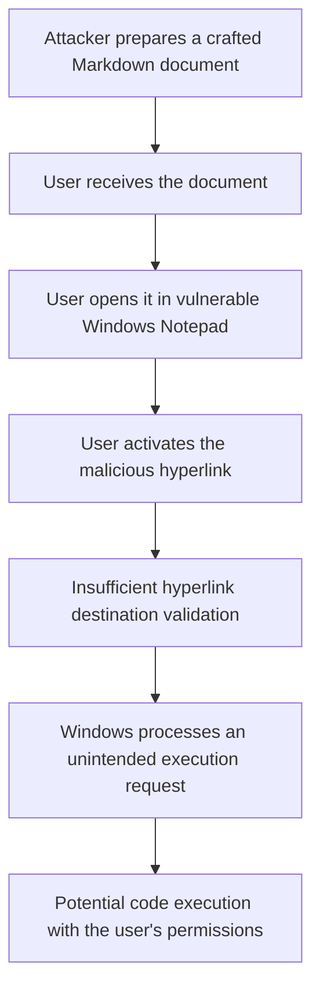

# Notepad RCE via Command Injection

## Overview

CVE-2026-20841 is a code execution vulnerability in the modern Microsoft Windows Notepad application. It is associated with the handling of hyperlinks in Markdown (`.md`) documents.

A specially crafted Markdown document can cause a vulnerable version of Notepad to initiate an unintended execution action when a user activates a malicious hyperlink. If exploitation succeeds, code may run with the permissions of the affected user.

Although Microsoft titles the vulnerability Remote Code Execution (RCE), its current CVSS assessment classifies the attack vector as local because exploitation requires interaction on the target system. Opening the document alone is not sufficient for the documented hyperlink-based attack.

## Vulnerability Details

| Property | Description |
| --- | --- |
| CVE ID | CVE-2026-20841 |
| Affected application | Microsoft Windows Notepad |
| Vulnerability type | Remote Code Execution (RCE) |
| Weakness classification | CWE-77 — Command Injection |
| CVSS 3.1 base score | **7.8 / 10 (High)** |
| Attack vector | Local (AV:L) |
| Attack complexity | Low (AC:L) |
| Privileges required | None (PR:N) |
| User interaction | Required (UI:R) |
| Scope | Unchanged (S:U) |
| Confidentiality, integrity and availability impact | High |
| Public disclosure | February 10, 2026 |

**CVSS vector:** `CVSS:3.1/AV:L/AC:L/PR:N/UI:R/S:U/C:H/I:H/A:H`

Earlier reports cited a score of 8.8. This document uses Microsoft's updated score of 7.8, as recorded in the NVD.

## How the Vulnerability Works

Modern Windows Notepad introduced Markdown support, enabling formatted text and interactive hyperlinks. A normal Markdown hyperlink directs the user to a website or another intended resource.

The vulnerability arises when Notepad inadequately validates an untrusted hyperlink destination before handing it to Windows. A crafted destination may be treated as an execution request instead of an ordinary link. Under vulnerable conditions, this can result in unintended code execution in the user's security context.

For example, a normal Markdown hyperlink looks like this:
[Visit Google](https://google.com)

The vulnerability does not inherently grant administrator or SYSTEM privileges, bypass UAC, or execute without user interaction.

## Attack Flow

The attack depends on an affected Notepad version, user interaction, and an execution request that can succeed in the target environment.

## Affected Versions

The following version range reflects Microsoft's updated affected-product data published in the NVD record.

| Windows Notepad version | Status |
| --- | --- |
| `11.0.0` up to but excluding `11.2512.26.0` | Affected according to Microsoft's published range |
| `11.2512.26.0` and later | Fixed for this vulnerability |
| Legacy Notepad without Markdown support | Not affected by this specific Markdown-based mechanism |

These are Notepad application versions, not Windows operating system build numbers. The published affected range is broader than the builds known to implement the vulnerable Markdown feature.

## Why Is It Called Command Injection?

Command injection occurs when untrusted input is interpreted as an instruction to execute rather than being handled strictly as data.

In this case, the security boundary is crossed when an untrusted Markdown hyperlink is passed to Windows without sufficient validation, allowing an unintended execution action. This is why Microsoft classifies the issue under **CWE-77 (Command Injection)**.

Unlike conventional shell command injection, this vulnerability is associated with unsafe hyperlink handling. It is not a buffer overflow or a memory corruption vulnerability.

## References

- [Microsoft Security Response Center — CVE-2026-20841](https://msrc.microsoft.com/update-guide/vulnerability/CVE-2026-20841)
- [NIST National Vulnerability Database — CVE-2026-20841](https://nvd.nist.gov/vuln/detail/CVE-2026-20841)
- [CERT Uganda — Windows Notepad App Remote Code Execution via Crafted Markdown File](https://www.cert.ug/windows-notepad-app-remote-code-execution-crafted-markdown-file-cve-2026-20841)
- [MITRE — CWE-77: Command Injection](https://cwe.mitre.org/data/definitions/77.html)
